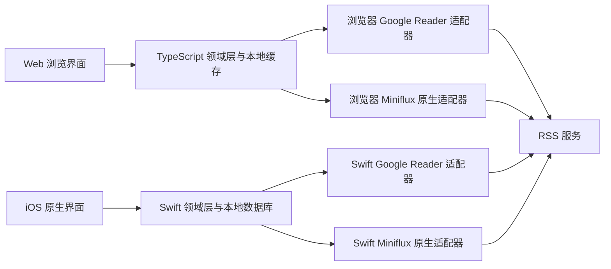

# Album RSS 产品与架构设计草案

日期：2026-10-15。本文件描述建议方案。仓库已按第 8 节初始化，Web 页面原型的设计与交互约定见 [Web 页面原型](ui-prototype.md)。

## 1. 产品定位

一个以图片浏览为主要体验的 RSS 客户端。RSS 服务负责订阅、抓取和文章状态；客户端负责将文章整理为图集、流畅查看图片和离线缓存。

第一阶段以个人使用、纯静态 Web 和原生 iOS 为目标。用户明确要求不开发自己的后端：两端直接连接既有 RSS 服务，不包含应用网关、Serverless API 或自建图片代理。内部数据结构支持多账号，但第一版界面可以先只开放单账号。后续可增加其他服务的专属适配。

### 浏览体验

- 默认采用图片瀑布流，参考小红书、Pinterest 和相册的浏览方式。暂以一篇文章对应一张图集卡片建模，显示封面、图片数量和少量来源信息；卡片粒度仍可在后续交互讨论中调整。
- 瀑布流属于首版产品方向，不再后置。视觉风格（浅色内容社区）、卡片文字密度（图 + 作者行）、比例裁切和图集打开方式（沉浸查看器）已在原型中确定，见 [Web 页面原型](ui-prototype.md)。
- 为瀑布流保留图片尺寸与比例，尺寸未知时使用占位布局。后续实现需验证加载引起的位移、长图占用、追加分页、滚动位置恢复和大量卡片的渲染性能。
- 可切换“图片流”：展开所有文章图片，适合连续看图；同一文章的图片仍保留分组和跳转入口。
- 打开卡片进入图集，支持左右翻页、缩放、保存、分享、查看文章和跳转原文。
- 暂拟 iOS 底部入口为浏览、收藏、订阅、设置；Web 桌面使用左侧导航、中央瀑布流、图片查看器，移动 Web 使用底部导航。具体导航与查看器交互后续讨论。
- 默认仅展示有图片的文章；无图片文章仍存在本地，可切换显示。图片未解析、加载失败与确实无图必须区分。
- 进入图集且至少一张图片成功展示后标记文章已读。用户可以关闭自动已读；列表滚动和预加载不会标记已读。
- 未读列表中正在查看的文章不会因为状态更新立即消失，在离开查看器或显式刷新时更新列表。

服务端已读与收藏的单位是文章。第一版收藏整篇图集；单张图片的保存是系统下载操作，不等同于服务端收藏。日后若加入单图收藏，应明确其独立存储与跨端同步方案。

## 2. 总体架构



两端共享模型定义、行为规范、解析样例和协议测试数据；TypeScript 与 Swift 分别实现运行时逻辑。暂不引入跨语言核心，以减少构建、调试和原生集成负担。

Web 构建为静态文件，可部署到静态托管服务或用户现有服务器；iOS 同样直接访问用户的 RSS 服务。服务适配、图片解析、缓存和同步都在客户端运行。

浏览器直连需要目标 API 支持 CORS，或将静态 Web 与 API 部署在相同源（协议、主机、端口均相同，仅域名相同不够）。当前 Miniflux 原生 API 的源码包含 CORS 中间件，允许 X-Auth-Token 等请求头，适合优先实现。Google Reader 协议兼容不代表浏览器跨域可用，其 Web 支持必须针对实际服务与部署验证。不能使用 no-cors 或 Service Worker 绕过限制。用户若愿意，也可以调整既有 RSS 服务入口的跨域配置；这不是应用必须开发或托管的后端。

Web 登录流程应测试实际鉴权请求并说明无法连接的可能原因。浏览器的网络错误通常无法精确区分 CORS、证书和连通性问题，不显示未经确认的单一诊断。HTTPS 页面连接 HTTP 服务、局域网访问与浏览器权限也需要实测。

## 3. 账号与服务适配

账号类型区分服务产品与协议：

- `generic-greader`：通用 Google Reader 兼容服务。
- `miniflux`：使用 Miniflux API Key 和原生 REST API。
- 后续如 `freshrss`，在通用实现上增加服务特定行为。

Miniflux 直接使用原生 API，获得分类查询、全文抓取和更丰富的筛选，不要求用户同时配置两套凭据。用户也可将 Miniflux 作为通用 Google Reader 服务添加，但此模式不会自动获得原生能力。未来若允许同一账号混用协议，必须先验证两套凭据属于同一用户，并验证 ID 映射。

### 统一接口

建议提供以下领域操作，不让 UI 直接依赖远端路径或字段：

```text
authenticate()
getCapabilities()
listFeeds()
listFolders()
listEntryIDs(query, cursor)
fetchEntries(ids)
listEntries(query, cursor)      可选的直接内容查询
setRead(entryIDs, desiredState)
setStarred(entryIDs, desiredState)
markScopeRead(scope, before)
```

全文抓取、远端搜索、订阅管理、主动刷新通过独立可选接口提供。

能力表至少包含：按分类查询、远端搜索、全文抓取、主动刷新、批量状态设置、变更时间筛选、订阅编辑、图片代理策略。能力表示可用操作，分页、ID 和状态同步差异仍由适配器处理。

对于 Google Reader 服务，不以 HTTP 200 判断某功能可用；Miniflux 未实现的路径可能返回 200 和空数组。初始支持范围应明确为核心阅读与状态同步，并针对实际后端维护经过验证的配置。认证也应可扩展，不能假设所有同类服务都使用 ClientLogin。

### Miniflux 第一阶段增强

- 使用 API Key。
- 原生按分类查询文章与搜索。
- 利用现有正文和附件提取图片。
- 用户显式请求时抓取全文，再重新解析图片；不默认为每篇文章抓取全文。
- 支持手动刷新订阅，并显示可获取的抓取错误。
- 保留服务返回的图片代理地址，不自行推导或签署 Miniflux 代理 URL。
- 根据版本与操作验证启用可选能力，遇到不支持的功能有明确降级。

## 4. 数据模型

| 实体 | 主要字段 |
| --- | --- |
| Account | 本地 UUID、服务类型、基础 URL、能力、凭据引用 |
| Feed | 账号 ID、远端 ID、标题、订阅地址、网站地址、图标 |
| Folder | 账号 ID、远端 ID、标题 |
| FeedFolder | 订阅与文件夹关系，允许多对多 |
| Entry | 账号 ID、远端 ID、订阅 ID、标题、作者、时间、原文地址、正文、服务端状态 |
| ImageAsset | 文章 ID、顺序、资源标识、加载地址、候选地址、尺寸、说明、提取来源 |
| EntryPresentation | 封面、图片数量、解析状态、正文哈希、解析器版本 |
| PendingMutation | 文章 ID、操作字段、目标状态、本地序号、重试信息 |
| SyncState | 账号 ID、同步范围、游标、完成时间、检查点版本 |

所有远端 ID 在模型和 JSON 中保存为字符串，避免 Google Reader 64 位 ID 在 JavaScript 中精度丢失。ID 以账号为命名空间。协议内部的十六进制与十进制转换由适配器承担。

`Entry` 是服务状态的主体，`ImageAsset` 是浏览资源。图片提取结果在正文哈希或解析器版本变化时重建。用资源标识尽量保留浏览位置；无法匹配时安全重置。签名 URL 是加载地址，不承诺其永久稳定。

第一阶段只有文章已读与收藏借由 RSS 服务跨端同步。图集浏览进度、布局、缓存和其他偏好在各设备本地保存。

## 5. 图片处理

### 提取

1. 用 HTML 解析器处理正文，绝不执行文章脚本。
2. 收集 `img` 的 `src`、`srcset`、`picture/source` 候选；以可配置规则处理懒加载属性。
3. 对照正文位置合并图片类型附件；视频封面后置，视频附件不当成静态图片。
4. 按文档顺序排列；根据可用的原文 URL 解析相对路径。
5. 去除明显追踪像素、重复图片和已确认的图标；未知尺寸的图片先保留，避免误删。
6. 保留 `alt`、`figcaption` 和已知宽高。

“图片流中的全部图片”指服务返回正文和附件中能提取的图片。不会保证抓取原网站图库中未进入 RSS 的所有图片。

### 加载

- 列表只加载适合当前展示尺寸的候选图；只有源站或既有 RSS 服务提供多个尺寸时，才减少实际下载字节。客户端缩小解码只能降低内存，不能降低原始下载流量，不新增缩略图后端。
- 查看器加载当前图片，有限预取前后图片；切换图集时取消无关任务。
- 保存图片和放大时优先使用已知的最高质量候选，不盲目修改 URL 猜测原图。
- 设置内存缓存、磁盘缓存、并发上限和缓存预算；显式下载与自动缓存分开管理。
- 失败时尝试下一个已知候选或重新获取文章以更新失效 URL；显示重试、原文入口，不无限重试。
- 对账号隔离缓存；登出清理凭据和相应私有缓存。

### Web 图片访问

跨域图片通常可以通过 `img` 展示，但 JS 下载、canvas 处理和生成缩略图还会受到 CORS 限制。API 调用同样需要既有服务允许跨域，或部署在同一源。

优先使用既有服务返回的可用代理地址，否则直接加载源站图片；不新增媒体代理。不得把 RSS API token 发送给图片源站。

Web 图片下载能力按资源验证：能通过 fetch 读取时提供保存与手动缓存；只能展示时提供打开图片或原文，由用户使用浏览器保存。跨域 download 属性不保证强制下载。无 CORS 的图片可能进入浏览器 HTTP 缓存，但不承诺可靠离线可用；第一版不将不可读的 opaque 响应纳入保证离线的图集下载。iOS 可直接下载可访问图片，不受浏览器 CORS 约束，但仍受源站认证、防盗链与平台网络策略限制。两端允许在图片保存和离线能力上存在差异。

Miniflux 的媒体代理模式与密钥由用户的服务器配置决定。客户端不能将“使用 Miniflux”直接等同于“所有图片都有可用代理”。

## 6. 同步与离线

### 首次同步

1. 登录并验证服务类型、能力。
2. 拉取订阅与文件夹。
3. 优先获取近期文章、未读和收藏；分批获取正文。
4. 增量解析图片，让已有结果立即显示，历史记录继续后台补齐。
5. 用户需要更早内容时按需回填；“没有有图结果”不代表远端文章已耗尽，继续分页直到达到目标或耗尽范围，并允许取消。

### 日常同步

- 应用打开、用户刷新和回到前台时同步；UI 始终先读本地数据。
- 新文章、文章状态和正文更新分开处理。
- 通用 Google Reader 适配器通过已验证的 ID 与内容接口读取数据，通过完整范围内的未读／收藏集合校对已缓存文章。部分分页结果绝不能当作完整集合。
- 不依赖发布时间发现状态变化；旧文章也可能在另一设备被标记已读。
- Miniflux 使用文章 ID 与变更时间筛选优化同步，但变更时间不应假定覆盖所有正文更新或提供严格变更日志。近期正文定期复查，单篇在需要时刷新。
- 分页策略由适配器定义。offset 分页期间远端集合可能变化，通过重叠窗口、ID 去重和最终校对减少遗漏；不承诺严格快照。
- 同步检查点只在当前批次成功落库后推进。
- 服务器删除和保留期限另做周期性校对；单次查询缺失不能直接解释成删除。

### 离线操作

已读和收藏先更新本地显示，再写入持久化待发送队列。操作记录“设为已读／未读”与“设为收藏／不收藏”，不用 toggle 表示用户意图。相同文章同一字段的待发送操作可合并为最后目标状态。

有未完成本地操作时，拉取状态不能覆盖本地期望值。发送成功后再校对远端；没有服务端版本或冲突接口时，只能做最终一致性，不声称跨设备严格按用户实际点击时间解决冲突。认证失败暂停队列并要求重新登录；超时退避重试，永久错误保留可见反馈。

离线可查看已经同步的元数据和已可靠缓存图片；不能把“同步过文章”理解成“所有原图已下载”。提供手动下载图集和缓存用量显示，Web 按资源可读性显示下载结果。浏览器存储可能因配额或清理被回收，Web 缓存不作为永久图片归档。Service Worker 缓存应用壳；首版刷新任务主要在页面打开时执行，不承诺关闭网页后继续同步。

iOS 的后台刷新是系统调度的机会性任务。首次打开与回到前台仍需可靠同步，不能承诺固定周期后台更新。

## 7. 技术选择

| 部分 | 建议 |
| --- | --- |
| Web | React、TypeScript、Vite；响应式布局，逐步增加 PWA |
| Web 本地存储 | IndexedDB：文章、图片索引、待发送操作；图片缓存按配额管理 |
| iOS | Swift、SwiftUI；复杂网格与缩放交互按需要使用 UIKit |
| iOS 本地存储 | SQLite + GRDB，便于批量更新、索引与迁移 |
| iOS 图片管线 | Nuke；在其上补充候选 URL、账号隔离和下载策略 |
| iOS 网络与凭据 | URLSession、Keychain |
| 共享规范 | JSON Schema、协议样例、图片解析 golden fixtures、行为规范 |

暂以 iOS 17+ 为建议基线，正式开发前结合目标设备确认。依赖版本在建项目时固定。

Web 凭据由浏览器持有，不使用应用后端会话。默认 token 只保存在内存，刷新页面后重新输入；用户可主动启用“记住登录”，将 token 存入 IndexedDB，并在退出时清除。Google Reader 密码只用于换取 token，默认不保存密码。前端存储没有 HttpOnly 或 Keychain 等价保护，同源恶意脚本仍可能读取凭据；固定依赖、限制 CSP、不注入未经清理的 HTML、不加载第三方脚本。前端内置密钥加密不能解决这个问题。

Miniflux 使用 X-Auth-Token，请求默认不携带 cookie（credentials: omit）；不依赖 Miniflux Web UI 登录会话。针对其他服务，认证和凭据携带方式由适配器明确处理。日志和导出文件过滤密码、token 和敏感代理 URL。

Web 页面只渲染经过清理的文章内容；图片展示区不直接注入原始 HTML。第一版不创建额外应用云账号或中心文章数据库。

## 8. 同仓库组织

```text
album-rss/
  apps/
    web/                       Web 界面
    ios/                       Xcode 工程、资源、UI 与平台集成
  packages/
    core-ts/                   TypeScript 模型、解析与同步规则
    providers-ts/              浏览器直连服务适配器
  swift/
    AlbumCore/                 Swift Package：模型、存储、解析、同步
    AlbumProviders/            Swift Package：服务适配器
  contracts/
    schemas/                   中立模型定义
    fixtures/
      greader/                 登录、分页、状态、ID 与错误样例
      miniflux/                原生接口样例
      media/                   HTML 输入与期望图片提取结果
  docs/
    design.md
    decisions/                 架构决策
  scripts/
  .github/workflows/
```

TypeScript 部分使用 pnpm workspace；Swift 使用 Swift Package Manager。两端各自编译和发布，修改共享 contracts 时都运行对应一致性检查。测试样例不得包含真实凭据或私人订阅内容。

## 9. 实现顺序与验证

### 阶段一：完整阅读链路

- 先确定模型和图片解析 fixtures。
- 实现 Miniflux 原生和 Google Reader 核心适配。
- 使用现有 Docker 部署验证浏览器直连 Miniflux API 的认证、预检和状态回写，再打通 Web 瀑布流，随后完成原生 iOS 阅读流程。前三项已由 `scripts/check-local-cors.py` 覆盖（状态回写需显式 `--allow-write`），浏览器端到端结果见 [本地连接验证](local-connectivity.md)。
- 包括封面、图集翻页与缩放、文章级收藏、已读、缓存和错误反馈。
- 用 Miniflux 和 FreshRSS 验证真实协议行为与浏览器跨域部署，不以模拟成功代替服务兼容性。iOS 支持与 Web 支持分别记录。

### 阶段二：图片体验与同步完善

- 图片流、按需历史回填、手动下载、可靠离线队列。
- 验证跨端已读／收藏、超时重试、登录失效与同步中断恢复。
- 优化快速滚动、超大图解码、动画图、长图与缓存清理。
- 完成 Miniflux 全文抓取、搜索和刷新增强。

### 阶段三：扩展

- 多账号界面、其他服务的专属适配、更多部署方式。
- 评估客户端缩略图、增强筛选、本地单图收藏与数据导入导出。不添加自建同步服务；跨端浏览进度仅在既有服务提供合适接口时扩展。

验收重点：两端对同一正文提取顺序一致；离线操作在重连后正确回写；大列表不会一次下载所有原图；打开图集后列表不会跳动；媒体 URL 失效能恢复；一个后端的特殊字段不会进入通用 UI。

## 10. 资料与需实测事项

### 已有开发环境

- 用户指定可复用的 Miniflux Docker 部署位于 `D:\CodeProject\Develop Environment\miniflux`。
- 已检查 `docker-compose.yaml`：包括 Miniflux、PostgreSQL 15 和 Nginx 入口，主机端口映射为 `8880:80`，Miniflux 使用 `miniflux/miniflux:latest`。
- Compose 配置中的 BASE_URL 为 `https://miniflux.chiyukiruon.top`。本机入口候选为 `http://localhost:8880`，需验证入口配置、可达性及响应中的图片地址；该地址不是已验证可用的连接。
- 这是用户已有的 RSS 服务及入口，不增加客户端自己的后端。复用已有数据库时，联调使用测试账号或测试订阅，避免批量改变其他项目使用的阅读状态。本地验证脚本遵循同一约束：默认运行只读，状态回写测试需显式 `--allow-write`，只改动一篇文章并恢复。
- 初次只读检查未能访问 Docker 引擎。用户随后启动了该环境，后续本地 HTTP 验证确认 Miniflux 2.2.16 正常响应。未重建容器或更新镜像，详细结果见 [本地连接验证](local-connectivity.md)。
- 后续验证已添加用户提供的六个测试订阅，并获取到图片文章；原生 API 认证和 CORS 检查通过，Google Reader 跨域预检返回 405。无头浏览器端到端验证已完成：图片可经 `img` 显示并成功解码，但 JS fetch 读取全部失败，即展示可用、下载与可靠离线缓存不可用。代理图片可能使用配置中的公开域名，且媒体 CORS 与原生 API CORS 不同，前端需要分别处理。
- iOS 真机需要可达的局域网地址或域名，不能使用指向手机自身的 localhost。Web 入口与目标 API 的协议、浏览器权限和跨域行为需要一起验证。

建议方案与已核实的服务能力应分开看待。以下为本次查阅来源：

- [Miniflux 原生 API](https://miniflux.app/docs/api.html)
- [Miniflux 原生 API 的 CORS 中间件](https://github.com/miniflux/v2/blob/main/internal/api/middleware.go)
- [Miniflux Google Reader API 实现说明](https://github.com/miniflux/v2/blob/main/internal/googlereader/README.md)
- [Miniflux 媒体代理配置](https://miniflux.app/docs/configuration.html)
- [Miniflux 正文更新与 changed_after 的相关讨论](https://github.com/miniflux/v2/issues/4504)：用于说明需要实测的同步边界，不作为所有版本行为的保证。已实测到一个具体实例：`SetEntriesStatus` 会在写状态时设置 `changed_at=now()`（`internal/storage/entry.go`），因此本地回写测试也会前移该文章的 `changed_at`，依赖 `changed_after` 的增量同步可能重新拉取这一篇。
- [FreshRSS Google Reader API](https://github.com/FreshRSS/FreshRSS/blob/edge/docs/en/developers/06_GoogleReader_API.md)
- [浏览器 CORS](https://developer.mozilla.org/en-US/docs/Web/HTTP/Guides/CORS)
- [跨域图片与 canvas](https://developer.mozilla.org/en-US/docs/Web/HTML/How_to/CORS_enabled_image)
- [Apple 后台刷新](https://developer.apple.com/documentation/BackgroundTasks/refreshing-and-maintaining-your-app-using-background-tasks)
- [SwiftUI](https://developer.apple.com/documentation/swiftui)
- [GRDB](https://github.com/groue/GRDB.swift)
- [Nuke](https://github.com/kean/Nuke)
- [Vite](https://vite.dev/guide/)

正式开发时应针对用户实际 Miniflux 版本确认原生 API 跨域请求、正文、代理图片地址、变更筛选和状态回写行为；用户浏览器和 iOS 设备需要能直接访问该 Miniflux 实例。部署在静态托管服务上的 Web 页面不代表托管服务需要访问用户的 RSS 服务器。
